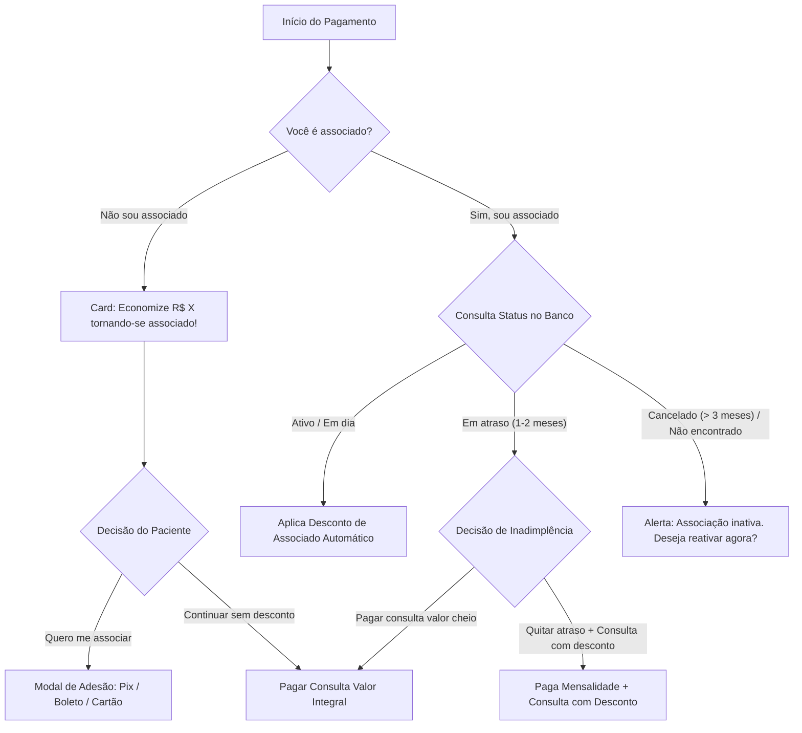

# Design Document: Associados e Regras de Negócio (Produção Real)

**Data:** 04/11/2026  
**Status:** Aprovado para Implementação  
**Escopo:** Frente 1 - Gestão de Associados, Regras de Negócio, Carência e Cobrança Multicanal (Pix, Boleto, Cartão)

---

## 1. Visão Geral e Objetivos

Este documento especifica a modernização e implementação definitiva das regras de negócio de **Associados** para operação em produção da plataforma MaisSaúde (Desktop da Clínica e Mobile do Paciente).

### Objetivos Principais:
1. **Eliminar falso positivo de assinatura:** Desvincular o status de associado do `localStorage` do navegador; a associação é validada 100% pelo CPF no banco de dados (Supabase) e na adimplência da Asaas.
2. **Carência e Inadimplência Inteligente (3 meses):**
   - Associado com 1 ou 2 meses em aberto permanece cadastrado (status `overdue`).
   - Se for agendar uma consulta no período de atraso, tem a escolha:
     - **Opção A (Regularizar):** Pagar mensalidade pendente + consulta com desconto.
     - **Opção B (Particular):** Pagar a consulta pelo valor integral de tabela, sem quitar a mensalidade naquele instante.
   - Após 3 meses consecutivos sem pagamento, a associação é suspensa (`cancelled`).
3. **Cobrança Multicanal de Mensalidade:**
   - Suporte a **Pix** (QR Code e Copia e Cola instantâneo), **Boleto Bancário** (código de barras e PDF) e **Cartão de Crédito** para pagamentos e regularizações.
4. **Sincronização em Tempo Real das Regras:**
   - Alterações de mensalidade, desconto e benefícios configuradas na clínica (`/desktop/associados`) refletem instantaneamente no aplicativo do paciente via API `/api/payments/subscription` e `/api/desktop/associate-rules`.
5. **Conversão Comercial no App Mobile:**
   - Ao selecionar "Não sou associado", exibe card promocional com cálculo real de economia na consulta e CTA para adesão imediata.
   - Ao selecionar "Sim, sou associado" sem cadastro ativo, exibe opção direta para se associar.
6. **Pagamento de Associado no Painel Desktop:**
   - Recepção pode emitir Pix, Boleto ou link de cartão da Asaas, bem como registrar pagamento presencial no balcão.
7. **Remoção de Termos Demonstrativos:**
   - Eliminar todas as referências a "simulado", "demonstrativo" e "demo" em telas, recibos e comprovantes.

---

## 2. Arquitetura de Dados e Esquema

### 2.1. Tabela `associates` (Supabase)
```sql
ALTER TABLE associates ADD COLUMN IF NOT EXISTS overdue_months INT DEFAULT 0;
ALTER TABLE associates ADD COLUMN IF NOT EXISTS next_due_date DATE;
ALTER TABLE associates ADD COLUMN IF NOT EXISTS last_paid_at TIMESTAMPTZ;
```
- `status`: `"active"` (em dia), `"overdue"` (1 a 2 meses em aberto), `"cancelled"` (3+ meses sem pagar), `"inactive"` (aguardando 1º pagamento).
- `overdue_months`: Inteiro de 0 a 3+.

### 2.2. Tabela `associate_rules`
- `fee`: Valor da mensalidade (R$).
- `consultation_discount_percent`: % de desconto nas consultas.
- `transport_enabled`: Habilita benefício de transporte.
- `transport_rides_per_month`: Quantidade de passagens.
- `extra_benefits`: Lista de benefícios adicionais em texto.
- `grace_months`: Limite de carência (padrão: 3 meses).

### 2.3. Tabela `payments`
- Campos existentes utilizados: `amount`, `method` (`"pix"` | `"card"` | `"boleto"`), `status` (`"pending"` | `"paid"` | `"refunded"` | `"declined"`), `invoice_url`, `pix_payload`, `bank_slip_url`, `identification_field` (linha digitável).

---

## 3. Endpoints de API

### 3.1. `/api/payments/subscription`
- **GET:** Retorna os dados do associado vinculado ao CPF do paciente autenticado:
  ```json
  {
    "active": boolean,
    "status": "active" | "overdue" | "cancelled" | "inactive" | "none",
    "overdueMonths": number,
    "pendingAmount": number,
    "rules": {
      "fee": number,
      "consultationDiscountPercent": number,
      "transportEnabled": boolean,
      "transportRidesPerMonth": number,
      "extraBenefits": string[]
    }
  }
  ```
- **POST:** Gera cobrança para adesão ou regularização de mensalidade via Asaas.
  - Body: `{ billingType: "PIX" | "CREDIT_CARD" | "BOLETO", monthsToPay?: number }`
  - Resposta: `{ value, billingType, invoiceUrl, pix: { payload, encodedImage }, bankSlipUrl, bankSlipBarcode }`

### 3.2. `/api/payments/cart`
- Suporte a item combinado no carrinho ou opção de regularização:
  - Permite passar flag `settleAssociateFee: boolean` junto com a consulta para faturar consulta com desconto + mensalidade pendente em uma única cobrança Asaas.

### 3.3. `/api/payments/associate` (Desktop)
- **GET:** Lista associados com status real, data de criação e histórico de adimplência.
- **POST:** Gera cobrança presencial da Asaas (Pix, Boleto ou Cartão) para o associado cadastrado no balcão.
- **PATCH:** Atualiza dados e status do associado no Supabase.

---

## 4. Fluxo de Usuário (Mobile & Desktop)

### 4.1. Mobile: Checkout da Consulta com Regra de Associado


### 4.2. Desktop: Gestão de Associados na Recepção
- Tabela com filtros de status: *Todos, Em dia, Em atraso, Cancelados*.
- Botão de ação por associado:
  - *Gerar cobrança:* Seleciona Pix, Boleto ou Cartão (com envio rápido de link para WhatsApp).
  - *Registrar baixa presencial:* Recebimento em dinheiro ou maquininha da clínica.

---

## 5. Limpeza de Termos Demonstrativos

- Substituição de `"simulado: true"` por dados reais nas tabelas.
- Ocultação/remoção visual de termos como `"demo"`, `"demonstrativo"`, `"simulado"`, `"simulação"` em:
  - [`src/components/mobile/profile-view.tsx`](file:///c:/Users/alder/maissaude/src/components/mobile/profile-view.tsx)
  - [`src/components/mobile/professional-view.tsx`](file:///c:/Users/alder/maissaude/src/components/mobile/professional-view.tsx)
  - [`src/components/desktop/finance-view.tsx`](file:///c:/Users/alder/maissaude/src/components/desktop/finance-view.tsx)
  - [`src/components/desktop/consultations-view.tsx`](file:///c:/Users/alder/maissaude/src/components/desktop/consultations-view.tsx)

---

## 6. Estratégia de Testes

1. **Testes Unitários:**
   - Validação da regra de carência (0 a 2 meses = `overdue`, 3+ meses = `cancelled`).
   - Cálculo de desconto quando adimplente vs valor integral quando opta por não quitar pendência.
   - Geração de cobranças Asaas com `PIX`, `CREDIT_CARD` e `BOLETO`.
2. **Testes de Integração:**
   - Endpoint `/api/payments/subscription` retornando dados reais de associados do Supabase sem vazamento do `localStorage`.
   - Atualização em tempo real de `associate_rules` entre Desktop e Mobile.
